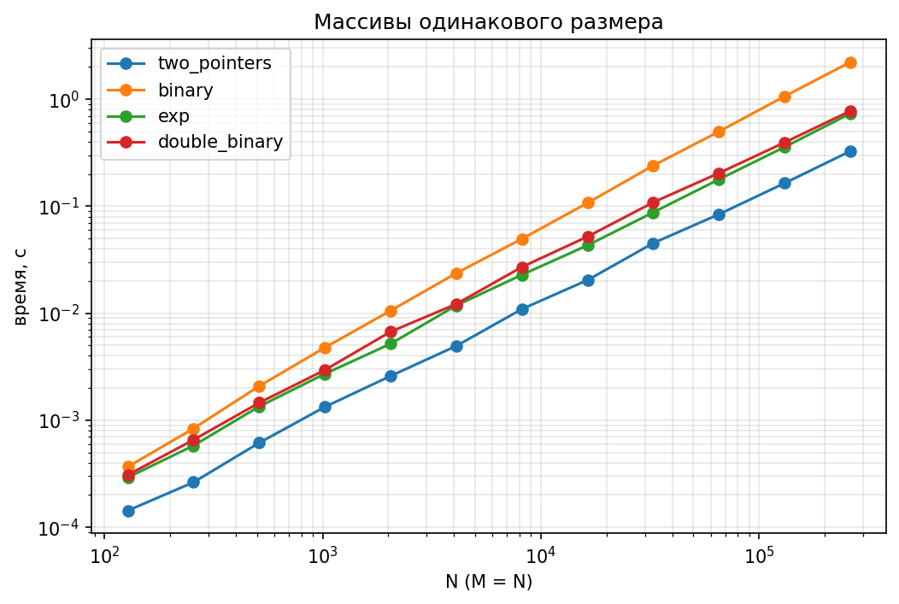
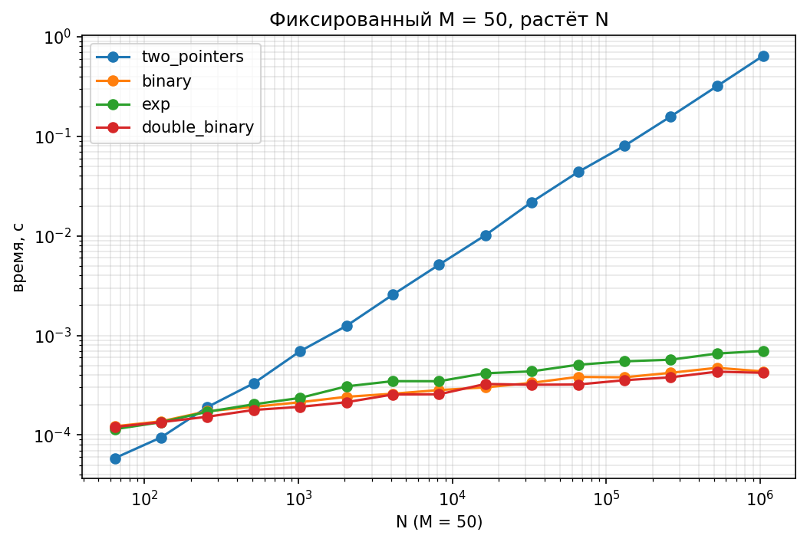
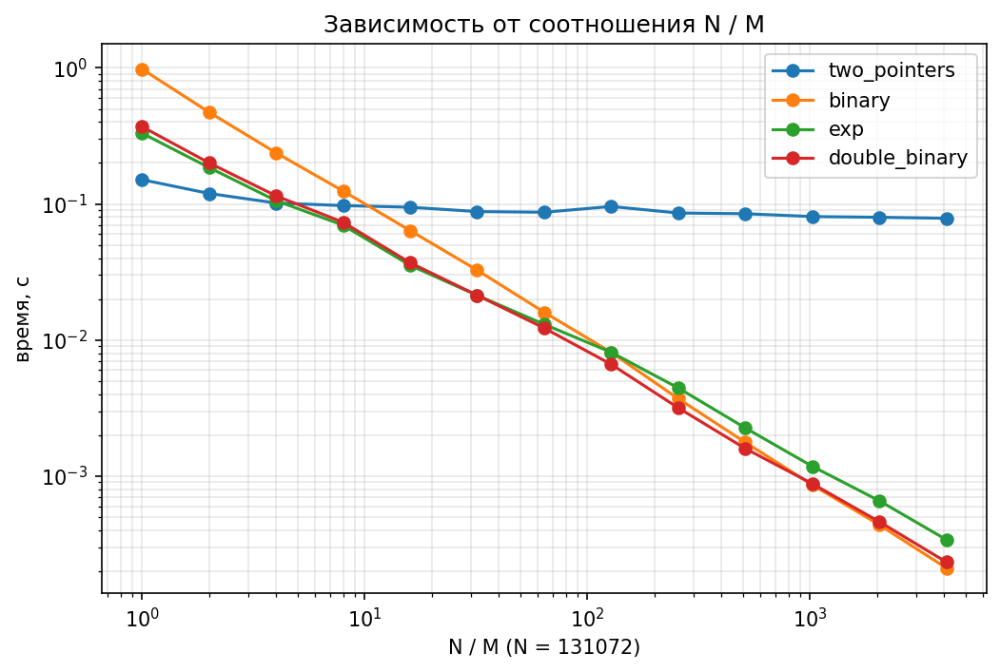

# Лабораторная работа 1: поиск общего элемента в двух отсортированных массивах

## Задача

Даны два отсортированных массива целых чисел (длины M и N). Нужно вернуть `True`, если в них есть хотя бы один общий элемент, иначе `False`. Реализованы четыре алгоритма, и выяснено, при каких размерах массивов какой из них эффективнее.

| Алгоритм | Функция | Время | Память |
|---|---|---|---|
| Два указателя | `two_pointers` | O(M+N) | O(1) |
| Бинарный поиск | `binary` | O(M·log N) | O(1) |
| Экспоненциальный | `exp` | O(M·log(2N/M)) | O(1) |
| Двойной бинарный | `double_binary` | O(M·log(2N/M)) | O(log M) |

## Структура проекта

- `alg.py` — реализация четырёх алгоритмов
- `test_alg.py` — тесты корректности (pytest)
- `run_pytest.py` — запуск тестов из любой среды
- `bench.py` — замеры времени, результат пишется в `data/results.csv`
- `plot.py` — построение графиков из `data/results.csv` в папку `plots/`
- `data/` — сырые данные замеров
- `plots/` — графики
- `requirements.txt` — зависимости (`matplotlib`, `pytest`)

## Запуск

```
pip install -r requirements.txt
pytest
python bench.py
python plot.py
```


## Как проводились эксперименты

**Тесты корректности.** Каждый алгоритм сравнивается с эталоном `bool(set(a) & set(b))` на заданных примерах (пустые массивы, общий элемент первый или последний, повторы внутри массива) и на 5000 случайных пар массивов.

**Тестовые данные (худший случай).** В массив A записываются нечётные числа, в массив B чётные, равномерно распределённые по общему диапазону. Общих элементов нет, поэтому каждый алгоритм работает до конца.

**Замеры.** Время измерялось через `time.perf_counter()`. Для каждой точки алгоритм запускался несколько раз (5 раз при N ≤ 10 000, иначе 3), записывалось минимальное время.

**Три серии экспериментов:**

1. M = N, размер от 128 до 262 144;
2. M = 50 фиксировано, N от 64 до 1 048 576;
3. N = 131 072 фиксировано, отношение N/M от 1 до 4096.

Графики построены с логарифмическими осями.

## Результаты

### 1) Массивы одинакового размера (M = N)



Быстрее всех «два указателя» (около 0,3 с на размере 262 144). Экспоненциальный и двойной бинарный примерно в 2,5 раза медленнее него. Бинарный поиск самый медленный (около 2,2 с): он делает N поисков по массиву длины N, то есть O(N·log N), а у «двух указателей» всего O(N) шагов.

### 2) Сильно асимметричные массивы (M = 50, N растёт до миллиона)



«Два указателя» обязаны пройти весь большой массив и на миллионе элементов работают около 0,6 с. Остальные три алгоритма отсекают большие куски массива и тратят меньше миллисекунды, то есть быстрее примерно в 900–1500 раз. Только при очень малых N (до N ≈ 200) выигрывает «два указателя».

### 3) Зависимость от соотношения N/M



График показывает точку перелома:

- при N/M ≲ 4 быстрее всех «два указателя»;
- при N/M ≳ 8 лучше экспоненциальный и двойной бинарный;
- обычный бинарный поиск обгоняет «два указателя» позже, при N/M ≳ 10–16;
- при очень больших N/M (от 500) бинарный и двойной бинарный практически сравниваются, экспоненциальный чуть позади.

## Выводы

- При M = N наиболее эффективен алгоритм «два указателя»: у него линейное время O(M+N) и самая маленькая константа. Бинарный поиск проигрывает сильнее всех из-за O(N·log N).
- При N/M ≳ 8 наиболее эффективны экспоненциальный и двойной бинарный поиск: они пропускают большие куски массива B, и их время зависит от M, а не от N.
- Между тремя «быстрыми» алгоритмами при больших N/M разница небольшая (в пределах 1,5–2 раз): теоретическое преимущество log(2N/M) над log N в Python скрывается за накладными расходами.
- Двойной бинарный поиск по скорости близок к экспоненциальному, но требует дополнительно O(log M) памяти на стек рекурсии.
